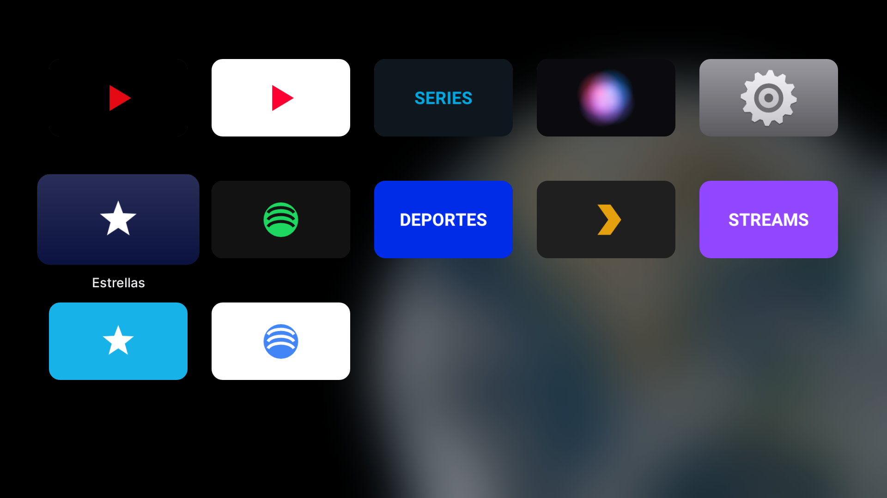
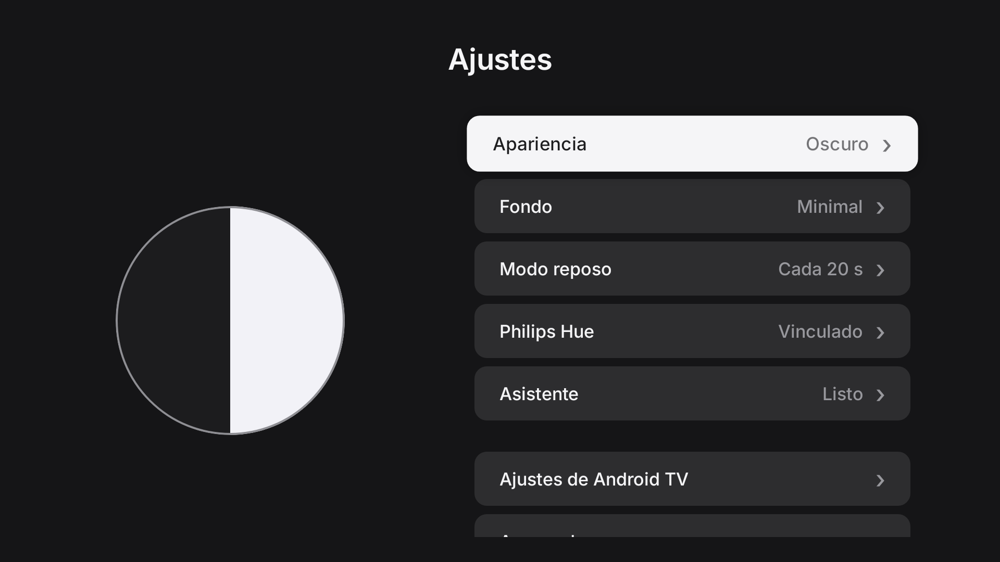
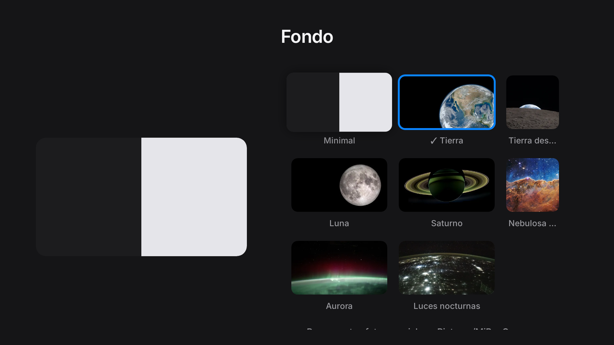
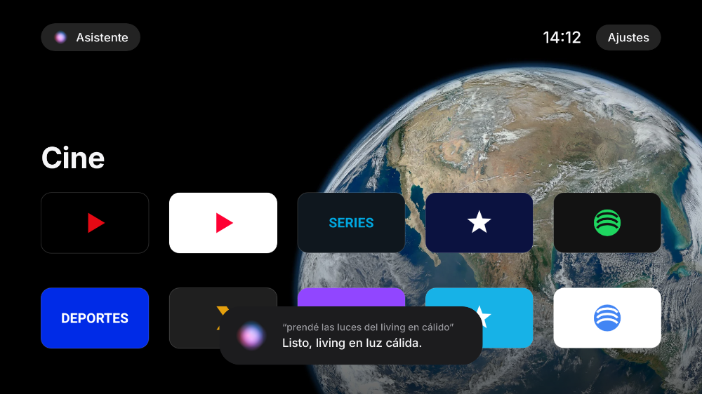
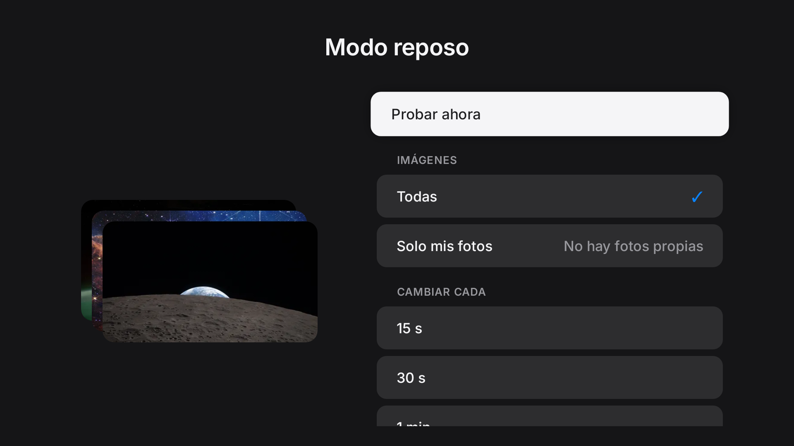

# MiBoxOs

Launcher con estética tipo Apple TV (tvOS) y asistente de voz con Gemini para la Xiaomi Mi Box S (Android TV 9).

- **Inicio estilo tvOS:** Top Shelf con el fondo elegido, íconos con el logo de cada app sobre un material desenfocado, brillo y sombra al enfocar, nombre solo bajo el ícono enfocado y orden por uso.
- **Ajustes (app en la grilla):** pantalla completa como Ajustes de tvOS, con apariencia clara/oscura, fondos (Minimal, Tierra, Luna, Saturno, nebulosa… de NASA, o tus fotos) y vinculación con Philips Hue.
- **Modo reposo (como los Aerials de Apple TV):** las imágenes pasan con zoom y desplazamiento lento, fundido entre una y otra, hora y nombre de la imagen. Es el protector de pantalla del sistema: arranca solo tras la inactividad, también dentro de otras apps.
- **Seguir viendo (Top Shelf):** lo que dejaste a medias en las apps que publican la fila "Watch Next" de Android TV, con barra de progreso; OK lo abre en ese capítulo.
- **Centro de control (como tvOS):** hora, Reposo, Asistente, claro/oscuro, Ajustes, habitaciones de Hue para prender/apagar y escenas. Se abre manteniendo el botón de voz (en cualquier app) o con Menú.
- **Asistente en cualquier app:** el botón de voz del control (el de Google Assistant) abre el asistente con Gemini encima de lo que estés viendo, sin pausarlo.
- **Asistente (app en la grilla, estilo Siri):** también con la tecla Buscar/Menú si el control la manda. Escucha hasta que te callás, manda el audio a Gemini y ejecuta: abrir apps, buscar en YouTube, play/pausa/siguiente, volumen, luces y escenas de Hue, abrir ajustes.

## Vista previa

Render real del código con apps ficticias (logos genéricos). El diseño sigue a tvOS: Top Shelf arriba, íconos sobre un material desenfocado, Ajustes como app con subpáginas y asistente estilo Siri.

| Inicio | Inicio al bajar de fila |
|---|---|
|  |  |
| **Ajustes** | **Fondo** |
|  |  |
| **Modo claro** | **Asistente** |
|  |  |
| **Modo reposo** | **Ajustes del modo reposo** |
|  |  |

Para regenerarlas: `./gradlew recordRoborazziDebug --tests '*ScreenshotTest*'`.

## Tests

`./gradlew testDebugUnitTest` corre 106 tests sobre Android 9 simulado (Robolectric), con un Hue Bridge y una API de Gemini falsos:

- **Uso con el control** (`MainActivityTest`): foco inicial, D-pad, OK abre apps, Atrás no sale del launcher, Ajustes (modo, fondo, foco al abrir/cerrar), botón Home, permisos, asistente de punta a punta (botón y tecla Menú), vincular Hue y usarlo por voz.
- **Asistente** (`AssistantControllerTest`, `ToolsTest`, `GeminiClientTest`, `VoiceRecorderTest`): sin API key, sin voz, errores de Gemini y de red, cancelación, cada acción.
- **Hue** (`HueClientTest`, `HueControllerTest`): vinculación con el botón, lectura de la casa, luces/brillo/color/escenas, certificado del bridge (rechaza impostores), bridge caído.
- **Apps y fondos** (`AppRepositoryTest`, `WallpapersTest`).

Lo que no cubren: el micrófono del control real, la API real de Gemini (sin key en CI), un bridge real y el rendimiento en la Mi Box.

## Requisitos

- Una compu en el mismo WiFi que la Mi Box, con [platform-tools (adb)](https://developer.android.com/tools/releases/platform-tools).
- API key de Gemini: <https://aistudio.google.com/apikey>.

## Instalación

1. **Habilitar ADB en la Mi Box:** Ajustes → Preferencias del dispositivo → Información → apretá 7 veces "Compilación". Después, en Opciones de desarrollador, activá *Depuración USB*. Anotá la IP (Ajustes → Red).
2. **Conectar:** `adb connect <IP>:5555` y aceptá el aviso en la TV.
3. **Instalar** (el APK sale de *Actions → Build APK → Artifacts*):
   ```
   adb install -r app-release.apk
   adb shell pm grant com.jsalinas.miboxos android.permission.RECORD_AUDIO
   ```
4. **Cargar la API key** (no queda en el repo, se guarda solo en la Mi Box):
   ```
   adb shell am start -n com.jsalinas.miboxos/.MainActivity --es gemini_api_key TU_KEY
   ```
   Opcional, cambiar modelo: `--es gemini_model gemini-3.6-flash` (por defecto `gemini-3.8-flash`).
5. **Probar** abriéndolo desde la lista de apps antes de hacerlo launcher por defecto.

## Fondos propios

Copiá imágenes (jpg, png o webp, idealmente 1920×1080) a `Pictures/MiBoxOs` y aparecen en Ajustes → Fondo:

```
adb shell mkdir -p /sdcard/Pictures/MiBoxOs
adb push mi-foto.jpg /sdcard/Pictures/MiBoxOs/
```

La primera vez que abras Ajustes la app pide permiso para leer archivos.

## Asistente en cualquier app y Centro de control

Usa un servicio de accesibilidad para recibir el botón de voz antes que Google Assistant. Activalo una vez:

- Desde la TV: Ajustes (de MiBoxOs) → Asistente → **En cualquier app** → Accesibilidad → MiBoxOs → activar.
- O por ADB:
  ```
  adb shell settings put secure enabled_accessibility_services com.jsalinas.miboxos/com.jsalinas.miboxos.global.GlobalAssistantService
  adb shell settings put secure accessibility_enabled 1
  ```

Uso: **toque corto** del botón de voz = asistente; **mantenido** = Centro de control. Atrás cierra.
Si el botón de voz no responde, en Ajustes → Asistente → **Botón del asistente** apretalo para que la app lo aprenda.
El permiso de micrófono se da una vez abriendo el ícono Asistente del inicio.

## Seguir viendo

Necesita el permiso de "listados de TV" (se pide al primer arranque; si lo rechazaste: Ajustes → Seguir viendo, o `adb shell pm grant com.jsalinas.miboxos android.permission.READ_TV_LISTINGS`). Aparecen las apps que publican su fila "Watch Next" en Android TV; si una app no la publica, no hay nada que mostrar de esa app.

## Modo reposo

En Ajustes → Modo reposo podés probarlo, elegir las imágenes (todas o solo tus fotos) y cada cuánto cambian. Para que Android TV lo use como protector de pantalla:

- Desde la TV: Ajustes → Modo reposo → **Activar en Android TV** → Protector de pantalla → MiBoxOs.
- O por ADB:
  ```
  adb shell settings put secure screensaver_components com.jsalinas.miboxos/.screensaver.ImageDream
  adb shell settings put secure screensaver_enabled 1
  ```

El tiempo de inactividad antes de que arranque se configura en los ajustes de Android TV (Protector de pantalla → Cuándo empezar).

## Philips Hue

En el ícono Ajustes → Philips Hue → **Vincular**, y apretá el botón redondo del bridge dentro de los 30 segundos. Usa la API local del bridge (no pasa por la nube). Después podés decirle al asistente cosas como "apagá las luces", "living al 30%" o "poné la escena Relajarse". La búsqueda del bridge usa el servicio de Philips (`discovery.meethue.com`), así que el bridge tiene que tener internet.

## Probar el micrófono

Abrí MiBoxOs, elegí el ícono "Asistente" y hablá. Si dice *"No te escuché (nivel máximo 0.00)"* el micrófono del control no le llega a apps de terceros. Alternativas: un micrófono USB en el puerto de la Mi Box, o controlarla desde el celular (pendiente).

## Hacerlo el launcher por defecto

Android TV no deja elegir launcher desde ajustes; hay que desactivar el de Google:

```
adb shell pm disable-user --user 0 com.google.android.tvlauncher
```

Para volver atrás:

```
adb shell pm enable com.google.android.tvlauncher
```

Hacelo solo cuando MiBoxOs ya funcione bien. Si algo sale mal, la TV puede arrancar en negro; se arregla con el comando de volver atrás.

## Compilar localmente

JDK 17+ y Android SDK (API 36): `./gradlew assembleRelease`. El APK queda en `app/build/outputs/apk/release/`.

## Limitaciones conocidas

- No probado en la Mi Box: si el botón de voz llega al servicio de accesibilidad (algunos firmwares lo procesan antes), si el micrófono del control funciona al grabar desde el servicio y qué apps publican "Seguir viendo".
- No navega adentro de las apps (por ejemplo, elegir un capítulo en Netflix).
- La búsqueda en YouTube usa un intent que no está verificado en la app de YouTube para TV de la Mi Box.
- La integración con Hue no está probada contra un bridge real todavía.

Fondos: ver [docs/WALLPAPER_CREDITS.md](docs/WALLPAPER_CREDITS.md).

## Licencias

La tipografía Inter está bajo SIL Open Font License 1.1 (`FONT_LICENSE_INTER.txt`).
