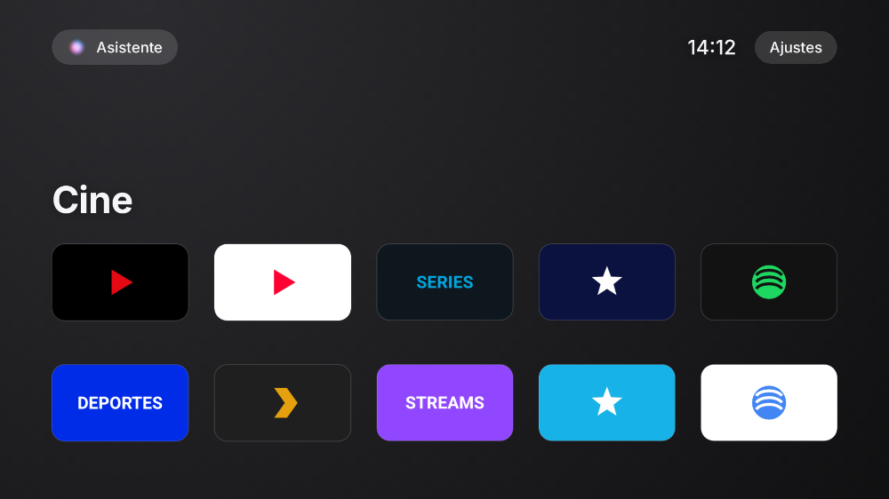
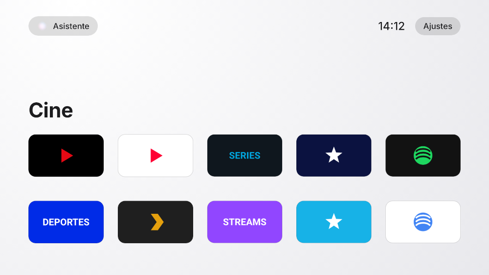
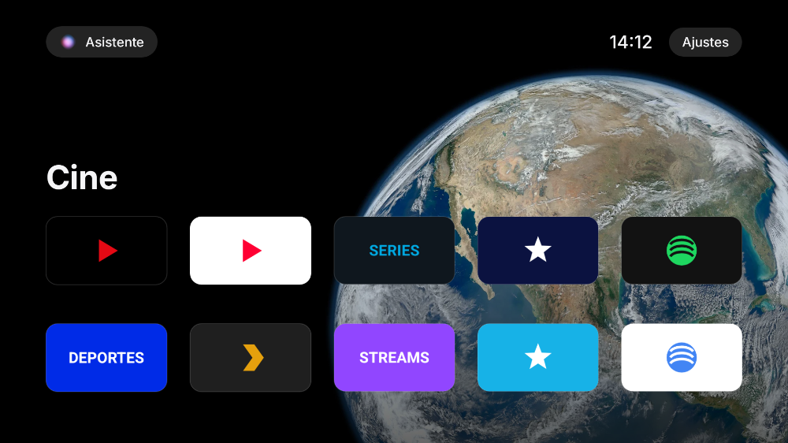
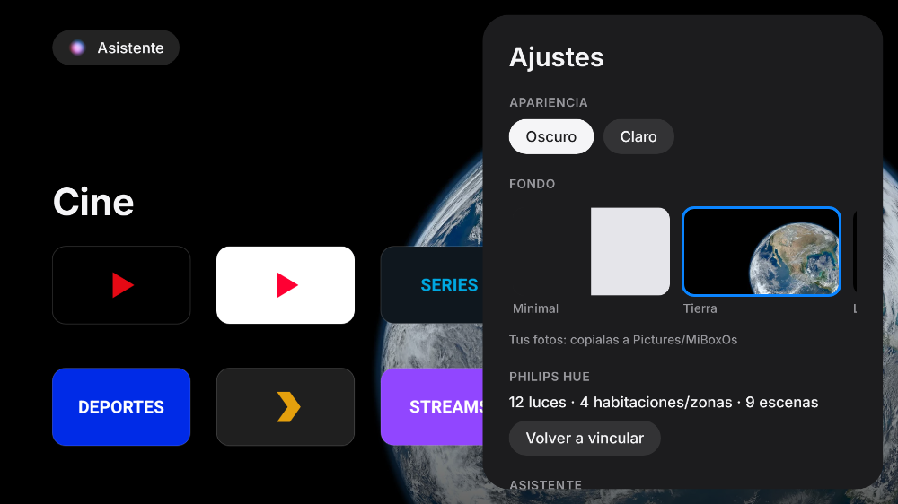

# MiBoxOs

Launcher con estética tipo Apple TV (tvOS) y asistente de voz con Gemini para la Xiaomi Mi Box S (Android TV 9).

- **Inicio:** grilla de apps 16:9 con el logo de cada app, nombre grande de la app enfocada, reloj y orden automático por uso.
- **Ajustes propios:** modo claro/oscuro, fondos (Minimal, Tierra, Luna, Saturno, nebulosa… de NASA, o tus fotos) y vinculación con Philips Hue.
- **Asistente:** botón "Asistente" en pantalla (o tecla Buscar/Menú si el control la manda). Escucha hasta que te callás, manda el audio a Gemini y ejecuta: abrir apps, buscar en YouTube, play/pausa/siguiente, volumen, luces y escenas de Hue, abrir ajustes.

## Vista previa

Render real del código con apps ficticias (logos genéricos). En la TV, la tarjeta enfocada se agranda y muestra el nombre abajo.

| Oscuro · Minimal | Claro · Minimal |
|---|---|
|  |  |
| **Fondo Tierra** | **Ajustes** |
|  |  |

Para regenerarlas (Paparazzi 1.3.x no lee la plataforma 36, por eso se compila contra la 35):

```
./gradlew recordPaparazziRelease -PcompileSdkOverride=35 -x checkReleaseAarMetadata
```

## Requisitos

- Una compu en el mismo WiFi que la Mi Box, con [platform-tools (adb)](https://developer.android.com/tools/releases/platform-tools).
- API key de Gemini: <https://aistudio.google.com/apikey>.

## Instalación

1. **Habilitar ADB en la Mi Box:** Ajustes → Preferencias del dispositivo → Información → apretá 7 veces "Compilación". Después, en Opciones de desarrollador, activá *Depuración USB*. Anotá la IP (Ajustes → Red).
2. **Conectar:** `adb connect <IP>:5555` y aceptá el aviso en la TV.
3. **Instalar** (el APK sale de *Actions → Build APK → Artifacts*):
   ```
   adb install -r app-release.apk
   adb shell pm grant com.jsalinas.miboxos android.permission.RECORD_AUDIO
   ```
4. **Cargar la API key** (no queda en el repo, se guarda solo en la Mi Box):
   ```
   adb shell am start -n com.jsalinas.miboxos/.MainActivity --es gemini_api_key TU_KEY
   ```
   Opcional, cambiar modelo: `--es gemini_model gemini-3.6-flash` (por defecto `gemini-3.8-flash`).
5. **Probar** abriéndolo desde la lista de apps antes de hacerlo launcher por defecto.

## Fondos propios

Copiá imágenes (jpg, png o webp, idealmente 1920×1080) a `Pictures/MiBoxOs` y aparecen en Ajustes → Fondo:

```
adb shell mkdir -p /sdcard/Pictures/MiBoxOs
adb push mi-foto.jpg /sdcard/Pictures/MiBoxOs/
```

La primera vez que abras Ajustes la app pide permiso para leer archivos.

## Philips Hue

En Ajustes → Philips Hue → **Vincular**, y apretá el botón redondo del bridge dentro de los 30 segundos. Usa la API local del bridge (no pasa por la nube). Después podés decirle al asistente cosas como "apagá las luces", "living al 30%" o "poné la escena Relajarse". La búsqueda del bridge usa el servicio de Philips (`discovery.meethue.com`), así que el bridge tiene que tener internet.

## Probar el micrófono

Abrí MiBoxOs, elegí "Asistente" y hablá. Si dice *"No te escuché (nivel máximo 0.00)"* el micrófono del control no le llega a apps de terceros. Alternativas: un micrófono USB en el puerto de la Mi Box, o controlarla desde el celular (pendiente).

## Hacerlo el launcher por defecto

Android TV no deja elegir launcher desde ajustes; hay que desactivar el de Google:

```
adb shell pm disable-user --user 0 com.google.android.tvlauncher
```

Para volver atrás:

```
adb shell pm enable com.google.android.tvlauncher
```

Hacelo solo cuando MiBoxOs ya funcione bien. Si algo sale mal, la TV puede arrancar en negro; se arregla con el comando de volver atrás.

## Compilar localmente

JDK 17+ y Android SDK (API 36): `./gradlew assembleRelease`. El APK queda en `app/build/outputs/apk/release/`.

## Limitaciones conocidas

- El asistente solo se puede invocar desde el inicio (no mientras estás dentro de Netflix). Para eso hace falta un servicio de accesibilidad: próximo paso.
- No navega adentro de las apps (por ejemplo, elegir un capítulo en Netflix).
- La búsqueda en YouTube usa un intent que no está verificado en la app de YouTube para TV de la Mi Box.
- La integración con Hue no está probada contra un bridge real todavía.

Fondos: ver [docs/WALLPAPER_CREDITS.md](docs/WALLPAPER_CREDITS.md).

## Licencias

La tipografía Inter está bajo SIL Open Font License 1.1 (`FONT_LICENSE_INTER.txt`).
